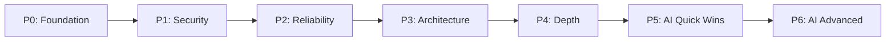

# HRMS Portfolio Improvement Plan

> Repo: `hrms-dashboard` (React 19 + Vite + MUI v7) + `hrms_backend` (Express 5 + Mongoose 9)
> Generated: 2026-10-17
> Scope: full project audit + portfolio-grade upgrade roadmap + AI feature plan

---

## 0. TL;DR

The HRMS project **works** and has a clean foundation (role-based auth, attendance, leaves, departments, notifications, dashboards), but it is at **tutorial-grade**. Reviewers who know the stack will spot: tokens in `localStorage`, zero tests, no input validation, dangling `populate()` calls, misspelled `attendence`, console.logs in production code, a duplicate admin/employee layout, dead files, hardcoded `localhost:5000` URLs, and missing features (payroll, holidays, MFA, audit log, real-time notifications).

Three parallel tracks turn this into a **portfolio-grade** product:

| Track | Outcome | Time |
|---|---|---|
| **A. Stabilize & harden** | Bug fixes, security baseline, lint/CI/tests, repo-wide `attendence → attendance` rename | 1–2 weeks |
| **B. Add depth** | Payroll, holidays, real-time, MFA, audit log, search, reports, PWA | 3–5 weeks |
| **C. Add AI** | Resume parser, HR chatbot, attendance anomaly detection, sentiment, predictive attrition, face punch-in | 4–6 weeks |

---

## 1. What the Project Does Today

A MERN HRMS with two role surfaces (admin, employee), JWT auth, refresh tokens, attendance punch-in/out, leave apply/approve, departments, employee CRUD, dashboard charts, and an in-app notification feed.

**Tech stack observed**

- Frontend: React 19, Vite 7, MUI v7, `@mui/x-date-pickers-pro`, `@tanstack/react-query` v5, axios, recharts, dayjs + date-fns, react-router-dom v6
- Backend: Express 5, Mongoose 9, JWT + bcrypt, multer, cookie-parser, CORS
- Infra: Netlify (FE), Render/Railway (BE), MongoDB Atlas

---

## 2. Drawbacks — Findings Backed by Source

Grouped by severity. Every finding cites the source file and (where useful) a line range.

### 2.1 Critical security issues

| # | Issue | Where | Why it matters |
|---|---|---|---|
| S1 | **Access token stored in `localStorage`** | `hrms-dashboard/src/api/axios.js:11`, `src/services/auth.service.js:7`, `src/utils/auth.js:2`, `src/auth/login.jsx:37` | Any XSS (3rd-party dep, `dangerouslySetInnerHTML`, image onerror) exfiltrates the JWT. README claims "Cookie-based refresh tokens" but the access token is still client-side. |
| S2 | **No input validation anywhere** | every controller under `hrms_backend/controllers/*.js` (e.g. `auth.controller.js:7-19`, `leave.controller.js:12-73`) | `{salary:"<script>", email:"not-an-email"}` is happily persisted. No Joi/Zod/express-validator wired up. |
| S3 | **No helmet, no rate limiting, no body-size limit** | `hrms_backend/server.js:1-40` (none of them imported) | Missing CSP, HSTS, brute-force protection; a single request can POST multi-GB JSON and exhaust memory. |
| S4 | **Refresh-token interceptor has no single-flight guard** | `hrms-dashboard/src/api/axios.js:24-43` | Multiple in-flight 401s fire parallel `/auth/refresh` calls → server-side single-use rotation blacklists all but the first → forced logout on every concurrent page load. |
| S5 | **Login leaks which credential is wrong** | `hrms_backend/controllers/auth.controller.js:37-44` | Returns `"Invalid email"` vs `"Invalid password"` → user enumeration → targeted brute force. |
| S6 | **Refresh tokens stored plaintext in Mongo** | `hrms_backend/models/user.js:16`, `controllers/auth.controller.js:62` | DB read = full token forgery for 7 days. |
| S7 | **`/uploads` served publicly with directory listing** | `hrms_backend/server.js:27, 33` | Anyone hits `/uploads/<filename>` for any profile pic, including deleted accounts (orphaned files). |
| S8 | **Multer: mimetype-only check, no `fileSize` cap, predictable filenames** | `hrms_backend/middleware/upload.js:20-32` | Mimetype is spoofable; `Date.now() + ext` can collide; no extension whitelist. |
| S9 | **`registerUser` reads `role` from request body** | `hrms_backend/controllers/auth.controller.js:7-9` | Currently gated by admin middleware, but the pattern is one copy-paste away from privilege escalation. |
| S10 | **Live secrets + demo password in committed `.env`/`README`** | `hrms_backend/.env`, `README.md:15-18` | `JWT_SECRET`, `REFRESH_SECRET`, `MONGO_URI` are on disk; demo creds in README. |

### 2.2 High-severity bugs (will be caught by QA or a code reviewer)

| # | Issue | Where | Why it matters |
|---|---|---|---|
| B1 | **Dangling `.populate()` never executes** | `hrms_backend/controllers/admin.controller.js:78-90` (`getAttendendenceById`), `107-122` (`filterAttendenceByDate`) | The chain has `.find(...)` then a free-standing `.populate(...)` with no receiver/await → response never includes employee details. |
| B2 | **`updateLeave` references undefined `status`** | `hrms_backend/controllers/leave.controller.js:170-176` | `${status}` throws `ReferenceError`; notification never fires; the silent failure masks a real bug. |
| B3 | **`getBalanceLeave` filters by lowercase `"approved"`** | `hrms_backend/controllers/leave.controller.js:227` | Schema enum is `["Pending","Approved","Rejected"]` → always zero matches → `usedDays` always 0 → feature is silently broken. |
| B4 | **`getAttendanceStats` references `a.employeeId` (field is `employee`) + wrong-case status** | `hrms_backend/controllers/admin.controller.js:355-376` | Dashboard widget always returns 0/0. |
| B5 | **`getAllAttendance` uses `fromDate`/`toDate` but schema has `startDate`/`endDate`** | `hrms_backend/controllers/admin.controller.js:36-40, 425-440` | "Leave" branch never resolves; "today" snapshot always shows Absent. |
| B6 | **`changePassword` returns 200 before `await user.save()`** | `hrms_backend/controllers/employee.controller.js:188-192` | If save throws, client still got 200. |
| B7 | **`markAsRead` has no ownership check** | `hrms_backend/controllers/notification.controller.js:36-44` | Any authed user can mark anyone's notification as read. |
| B8 | **`getAttendenceHistory` loads all records then filters in JS** | `hrms_backend/controllers/attendence.controller.js:107-127` | A user with years of history transfers thousands of docs every dashboard mount. |
| B9 | **Hooks-rule violation: `useDeleteLeave(selectedId)` called with arg** | `hrms-dashboard/src/pages/employee/leave/leave-table.jsx:50` | `useDeleteLeave` signature takes no args; React will warn and the hook runs with stale closures. |
| B10 | **`useGetLeaveById(id, options)` ignores second arg** | `src/pages/employee/leave/leave-table.jsx:45-48` + `src/queries/employee/leave.query.js:29-34` | Caller passes `{enabled: !!selectedId}` but the hook signature drops it → query runs when `selectedId` is null → 400/500 from backend. |
| B11 | **App router: `<Route path="/*" element={<AdminRoutes />} />` swallows everything** | `hrms-dashboard/src/App.jsx` | A typo or unknown URL renders the admin guard and bounces to `/`; no 404 page, can't tell what happened. |
| B12 | **`AdminProfile` destructures wrong React Query fields (`loading` instead of `isLoading`)** | `src/pages/admin/profile/admin-profile.jsx:14` | `loading` is undefined → branch never renders; `error` is checked against the wrong field. |
| B13 | **Hardcoded `http://localhost:5000` in production** | `src/pages/admin/employee/employee-details.jsx:91-94` | Profile pics 404 in prod. |

### 2.3 Code quality / maintainability

| # | Issue | Where |
|---|---|---|
| Q1 | **14 production files contain `console.log`/`console.error`** | `src/routes/admin/admin-route.jsx:8-9`, `src/layouts/employee-layout.jsx:9`, `src/components/common/navbar.jsx:32`, `src/pages/admin/dashboard-admin/attendence-chart.jsx:14`, `src/services/auth.service.js:11,29`, `src/services/employee/*.service.js`, etc. |
| Q2 | **Syntax bug: `sx={{ fontSize: { xs: 12, md: 14, color: "white" } }}`** — `color` nested inside responsive fontSize | `src/components/common/statCard.jsx:14` |
| Q3 | **Dead files: `src/auth/protected-route.jsx`, `src/data/mock-employee.js`, `hrms_backend/uploads.js`** | entire files; zero callers |
| Q4 | **Dead exports** | `services/admin/attendance.service.js → getAttendanceByFilters`, `services/admin/department.service.js → assignEmployeeToDepartment`, `queries/admin/department.query.js → useAssignEmployeeToDepartment` (also broken — wires to wrong endpoint), `queries/admin/attendance.query.js → useTodayAttendanceSnapshot` (unreachable `keepPreviousData` after `return`) |
| Q5 | **Two date adapters (dayjs + date-fns)** | `src/pages/employee/leave/leave-request.jsx` uses dayjs; `src/components/common/table-filter-bar.jsx` uses date-fns |
| Q6 | **Paid `@mui/x-date-pickers-pro` imported but `DateRangePicker` never used** | `src/components/common/table-filter-bar.jsx:12` |
| Q7 | **Duplicate avatar URL builder in 6 places** | `pages/admin/attendance/attendance-table.jsx`, `pages/admin/employee/employee-table.jsx`, `pages/admin/employee/employee-details.jsx`, `pages/admin/leaves/leave-table.jsx`, `pages/employee/profile/profile.jsx`, `pages/employee/profile/profile-edit-page.jsx` |
| Q8 | **Near-identical admin/employee layouts and sidebars** | `layouts/admin-layout.jsx` vs `layouts/employee-layout.jsx`; `components/admin/admin-sidebar.jsx` vs `components/employee/employee-sidebar.jsx` (~95% duplicated) |
| Q9 | **Inconsistent query keys across roles** | Admin uses `["attendance"]`, `["attendance","today-snapshot"]`; employee uses `["attendance","today"]`, `["attendance","history"]` → invalidations thrash the wrong cache |
| Q10 | **`theme.js` exists but `<ThemeProvider>` is never registered** | `src/themes/theme.js`, `src/main.jsx` |
| Q11 | **Two distinct profile queries for same logical data** | `src/queries/admin/profile.queryjs` (note `.queryjs` typo) calls `/auth/profile`; `src/queries/employee/profile.query.js` calls `/employee/profile` |
| Q12 | **`PageTitleBar` has unused `buttonIcon` prop; hardcodes `<Add />`** | `src/components/common/page-title-bar.jsx` |
| Q13 | **Inconsistent error shapes** | Backend returns `{message}`, `{error}`, `{m:"…"}` arbitrarily across controllers |
| Q14 | **`uploads.js` (root) is empty** | `hrms_backend/uploads.js` |
| Q15 | **TODO / "fixed" / "use res instead of req" history comments** | `controllers/leave.controller.js:59`, `controllers/department.controller.js:11, 84, 107` |

### 2.4 Performance / scalability

| # | Issue | Where |
|---|---|---|
| P1 | **Unread-count polling every 10 s per user, no background throttling** | `src/queries/notification.query.js:34`, used in `navbar.jsx:31` |
| P2 | **No `staleTime`/`gcTime` set globally** | `src/main.jsx:7-13` — every mount refetches |
| P3 | **`queryClient.invalidateQueries(["attendance"])` invalidates unrelated queries across roles** | `src/queries/admin/attendance.query.js:36`, `src/queries/employee/attendance.query.js:15,26` |
| P4 | **`profileImage` cache-buster `?t=${Date.now()}` on every render** | `src/pages/employee/profile/profile.jsx:93`, `profile-edit-page.jsx:57,117` |
| P5 | **`getAllAttendance` loads all employees into memory, paginates after `slice`** | `hrms_backend/controllers/admin.controller.js:24-67` — `total` is pre-paginate, O(N·M) |
| P6 | **`getDepartment` runs `countDocuments` per department** | `hrms_backend/controllers/department.controller.js:17-37` — N queries, single `$group` would suffice |
| P7 | **No `.lean()` on read-only endpoints** | `getEmployees`, `getAllLeaves`, `getAttendenceHistory` |
| P8 | **No indexes declared on any model** | every schema — `(employee, date)` lookups do collection scans |
| P9 | **No `compression` middleware** | `hrms_backend/server.js` |
| P10 | **`getAttendanceTrend` groups 30 days of records in JS** | `hrms_backend/controllers/admin.controller.js:389-422` |

### 2.5 Data modeling

| # | Issue | Where |
|---|---|---|
| D1 | **No compound unique `(employee, date)` index on attendance** | `hrms_backend/models/attendence.js:5-22` — two parallel punch-ins can create duplicates |
| D2 | **`Employee.phone` stored as `Number`** | `hrms_backend/models/employee.js:9` — loses leading zeros, breaks for numbers > 2^53 |
| D3 | **No `min: 0` on `salary`** | `models/employee.js:11` — negatives allowed |
| D4 | **`Department.head` and `Employee.user` have no cascade/cleanup** | `models/department.js:8-11`, `models/employee.js:12` — orphaned references on delete |
| D5 | **`Notification.user` references `Employee`, but admins are `User`** | `models/notification.js:5-9` — admin notifications addressed via `User` mismatch |
| D6 | **No soft-delete / audit fields** | all models — HR data usually requires retention/audit |
| D7 | **`attendence.status` enum diverges from runtime values** | schema is `["Present","Half-Day","Completed","Absent","On Leave","Late"]`; `calculate-status.js` only returns `Present | Half-Day | Late`; admin controllers compare lowercase `present | leave` |
| D8 | **Email uniqueness but no `lowercase: true`/`trim`** | `models/user.js:8`, `models/employee.js:6` — `Alice@x.com` and `alice@x.com` are two records |

### 2.6 Error handling

- No global error-handler middleware; `next(err)` pattern unused; controllers have no try/catch on many async handlers → unhandled rejections crash the worker. (`server.js` lacks `app.use((err,req,res,next) => …)`.)
- Errors leak `err.message` to clients everywhere (`auth.controller.js:24,82,116,137`, `employee.controller.js:37,82,99,…`).
- No distinction between 4xx and 5xx — `department.controller.js:9-11` returns 400 on connection drops.

### 2.7 Accessibility (a11y)

- **One** `aria-label` in the entire frontend (`navbar.jsx:68`).
- No `aria-current="page"` on sidebar nav; icon-only buttons (`MoreVert`, `Edit`, `Delete`) have no labels.
- Status colors are color-only (`Chip color`) — colorblind users can't tell Approved/Rejected/Pending.
- `window.confirm()` for deletes is not announced in the React a11y tree.
- No "skip to content" link — keyboard users tab through every sidebar item.
- Avatar `` has no `alt`.

### 2.8 UX / UI gaps

- `alert()` in 5 places, `window.confirm()` in 4 delete flows.
- No skeleton loaders — shows raw `<CircularProgress />`, literal `Loading…` text, or `null`.
- No global toast layer (`notistack` or MUI Snackbar not installed).
- No error boundary — a render error blanks the page.
- "Forgot password?" link is non-functional (`src/auth/login.jsx:113-115`).
- "Generate Reports" quick-action navigates to `/admin/reports` which doesn't exist (`quick-actions.jsx:49-54`).
- Login form: no disabled-while-submitting, no spinner, no "remember me" → double-click submits twice.
- Admin nav has no change-password link/ route.
- Date filters don't reset page state (`pages/admin/attendance/attendance.jsx:75-82`).
- No 404 page.
- Mobile sidebar is `Drawer variant="permanent"` — unusable on phones.

### 2.9 Testing / CI / docs

- **Zero tests.** No vitest, jest, RTL, cypress, playwright. No `__tests__/`, no `*.test.*`.
- No `.github/workflows/`, no `Makefile`, no pre-commit.
- No `engines` field in `package.json`, no `.nvmrc`.
- README is 37 lines, partly wrong (env URL mismatch — `.env` uses `onrender.com`, README says `railway.app`; claim of "cookie-based refresh tokens" contradicts localStorage usage; demo password baked in).
- No API docs (OpenAPI/Swagger/Postman).
- No `.env.example` shipped; `hrms_backend/.env` is committed in spirit (gitignored but shipped).
- No JSDoc on public hooks/services.
- `useApplyLeave` service throws `new Error("Failed to apply for leave:", err.response?.data || err.message)` — comma not `+`, error object is dropped.

---

## 3. What to Add to Make It Portfolio-Grade

Organized by effort and impact. Items marked **(Quick Win)** take <1 day each and dramatically raise review quality.

### 3.1 Foundation / "looks serious"

1. **(QW)** Repo-wide rename `attendence → attendance` (sed or codemod).
2. **(QW)** Delete dead files/exports (`protected-route.jsx`, `mock-employee.js`, `hrms_backend/uploads.js`, unused query hooks).
3. **(QW)** Fix all confirmed bugs (B1–B13).
4. **(QW)** Strip all `console.log`; add ESLint rule `no-console: ["error",{allow:["warn","error"]}]`.
5. **(QW)** Add Vitest + React Testing Library + 8–10 starter tests (login, auth context, route guards, one page render).
6. **(QW)** Add GitHub Actions: `lint + test + build` on Node 20/22.
7. **(QW)** Add Husky + lint-staged pre-commit.
8. **(QW)** Add `.env.example` to both repos; remove secrets from README.
9. **(QW)** Move JWT to httpOnly cookie; keep user profile in memory only.
10. **(QW)** Single-flight refresh-token guard in `axios.js`.

### 3.2 Security hardening (1 PR each)

11. Add `helmet`, `compression`, `express-rate-limit`, `express-mongo-sanitize`, `xss-clean`, `hpp`.
12. Add `express.json({limit:"100kb"})`, `express.urlencoded({extended:true,limit:"100kb"})`.
13. Add `zod` schemas + `validate` middleware; apply at router level. Cover all 30+ endpoints.
14. Add CSRF token (double-submit cookie) for state-changing cookie routes.
15. Hash refresh tokens server-side (bcrypt or rotating store).
16. Generic "Invalid credentials" + constant-time bcrypt compare against dummy hash.
17. Replace `Date.now() + ext` upload filenames with `crypto.randomUUID()`; add `limits:{fileSize:2*1024*1024,files:1}`; magic-byte sniff (`file-type`); no public `/uploads` mount — authenticated proxy or signed URLs.
18. Add `accountLockUntil`/`failedLoginAttempts` to `User` model with lockout policy.
19. Strip `role` from self-service `req.body`; only admin flows pass role through whitelist.

### 3.3 Reliability / observability

20. Add `express-async-errors` + global error middleware mapping `ValidationError`/`CastError`/11000 to safe shapes.
21. Replace `console.*` with `pino` (structured logs with redact list).
22. Add `morgan` request logging piped to pino.
23. Add `/healthz` (liveness) + `/readyz` (DB ping) endpoints.
24. Add Sentry (frontend + backend) for error reporting.
25. Add graceful shutdown (SIGTERM/SIGINT) handlers; drain in-flight requests.
26. Set `app.set('trust proxy', 1)` if behind a proxy.

### 3.4 Backend architecture

27. Extract `services/` layer — leave controllers are 200+ lines and mix parsing, business rules, notifications.
28. Add MongoDB indexes (compound `(employee, date)` unique, `(status, startDate)`, `(user, isRead, createdAt)`).
29. Convert `getAllAttendance`, `getAttendanceTrend`, `getDepartment`, `getTotalWorkHours*` to single-trip aggregations with `$group`/`$facet`.
30. Add `.lean()` on read-only endpoints.
31. Add `mongoose-delete` (soft-delete) + audit fields (`createdBy`, `updatedBy`, `deletedAt`).
32. Fix Phone to String + `match` regex; add `min:0` on salary; `lowercase:true` + `trim` on emails.
33. Add transaction (`withTransaction`) around multi-step flows (create employee + User, approve leave + notification, payroll run).
34. Generate OpenAPI 3 spec from zod schemas (zod-to-openapi) → Swagger UI at `/api/docs`.
35. Add Postman collection + a `seed.ts` script that prints the demo admin's random password once.

### 3.5 Frontend architecture

36. **(QW)** Unify `admin/*` and `employee/*` layouts/sidebars via a single `<AppShell role>`.
37. **(QW)** Wrap `<App />` in `<ThemeProvider>` + add a custom MUI theme + dark mode toggle (MUI `CssVarsProvider` + `next-themes`-style switch in navbar).
38. **(QW)** Centralize `getAvatarUrl()` helper — replace 6 duplicated implementations.
39. Pick one date library (drop `date-fns`); keep dayjs.
40. Drop `@mui/x-date-pickers-pro` (paid) unless you actually use `DateRangePicker`; replace with `DatePicker`.
41. Replace `alert()`/`window.confirm()` with MUI `<Snackbar>` + `<Dialog>` and a `notify()` helper.
42. Add `<ErrorBoundary>` in both layouts; share via context.
43. Add skeleton loaders (`<TableSkeleton>`, `<CardSkeleton>`).
44. Unify React Query keys by role: `["attendance","admin",filters]`, `["attendance","employee","today"]`.
45. Set global `defaultOptions.queries = { staleTime: 30_000, gcTime: 5*60_000 }`.
46. Add a global `QueryCache({ onError })` to surface errors via toast.
47. Move `localStorage` user info to React Query cache keyed `["me"]` and call `/auth/me` on mount (instead of trusting localStorage).
48. Migrate to TypeScript incrementally (or add JSDoc + `vite-env.d.ts` for env types) — reviewers notice.
49. Add Storybook for shared components (`StatCard`, `PageTitleBar`, `TableFilterBar`).
50. Add PWA (`vite-plugin-pwa` + `manifest.webmanifest`) for offline-friendly UX.
51. Add i18n (`react-i18next`) with `en`, `hi`, `ar` — small effort, big review impression.
52. Add a `/admin/reports` module so the existing quick-action doesn't 404 (CSV export, attendance summary, headcount).

### 3.6 Product features (the depth)

| Module | Backend | Frontend | Why portfolio-worthy |
|---|---|---|---|
| **Payroll** | `Payroll` schema (basic, HRA, allowances, deductions), `PayrollRun` schema, payslip PDF (`pdfkit` or `puppeteer`), monthly cron | `pages/admin/payroll/*` (run, view, export); employee self-service payslip download | Foundational HR module; nobody has this in tutorials |
| **Holidays & leave calendar** | `Holiday` schema; integrate into `getBalanceLeave` and `calculateStatus` | MUI Calendar view (FullCalendar or `react-big-calendar`) showing holidays, approved leaves, attendance | Visual eye-candy for reviewers |
| **MFA / TOTP** | `speakeasy` + `qrcode`; `/auth/mfa/setup`, `/auth/mfa/verify` | Setup wizard, QR scan, 6-digit code input | Security story |
| **Email + SMS notifications** | `nodemailer` (SendGrid/SES), `twilio`; templates for leave/attendance/payslip | toggle per channel in settings | Real product surface |
| **Real-time notifications** | `socket.io` (replace 10 s poll) | `socket.io-client` + toast on event | Live app feel |
| **Audit log** | `AuditLog` collection; middleware that records `who/what/when/before/after` on every mutation | `/admin/audit` page with filters | Compliance story |
| **Document management** | multer for non-image, versioned files, signed URLs, S3-compatible storage | upload UI, version diff, e-sign placeholder | Differentiator |
| **Performance reviews** | `ReviewCycle`, `Goal`, `Feedback` schemas | goal-setting wizard, 360° feedback form | HR-advanced |
| **Recruitment / ATS** | `JobPosting`, `Applicant`, `Interview` schemas; resume parsing (see AI §) | kanban pipeline view | Big portfolio item |
| **Shifts / flexible hours** | `Shift`, `Roster`; geo-fence punch-in (haversine) | shift calendar | Real product surface |
| **Search** | MongoDB text index + `/api/search` endpoint | global command palette (`⌘K`) with fuzzy search | UX polish |
| **Settings & roles** | RBAC with custom permissions, not just role enum | settings page for org-level config | SaaS feel |
| **Dark mode** | n/a | MUI `CssVarsProvider` + localStorage persist | Reviewers love it |
| **Mobile-first sidebar** | n/a | responsive Drawer, hamburger on small screens | Mobile showcase |

### 3.7 Documentation that signals quality

- Architecture diagram (Mermaid) in README: FE ↔ API ↔ DB ↔ S3 ↔ Email/SMS ↔ WebSocket.
- OpenAPI/Swagger UI at `/api/docs`.
- `CHANGELOG.md` with semantic versions.
- `CONTRIBUTING.md` (how to run, test, lint, add a feature).
- `LICENSE` (MIT).
- Loom / GIF demos of: login → apply leave → admin approves → real-time notification lands.
- A short "Design Decisions" doc explaining tradeoffs (why httpOnly cookies over localStorage; why a single-flight refresh; why aggregations over JS grouping).

---

## 4. AI Features to Add

Each item has a "what it does", "value to portfolio", "where it lives", "difficulty", and a recommended **free / cheap** stack (so the project stays free-tire deployable).

### 4.1 Quick-win AI features (≤1 day each, huge review impact)

#### 🤖 A1. AI HR Assistant Chatbot (RAG over policies)
- **What:** Employees ask "how many casual leaves do I have left?" / "what's the WFH policy?" — answers cite the source.
- **Stack:** `langchain` + `chromadb` (in-memory vector store is enough for ≤100 docs); LLM via **Groq free tier** (`llama-3.1-8b-instant`) or **OpenRouter free models**.
- **Where:** `pages/employee/assistant/`, `routes/assistant.js`, `services/rag.service.js`.
- **Why portfolio-worthy:** RAG is the most cited 2024–2026 skill. Real value, real product surface.

#### 🤖 A2. AI Payslip Explainer
- **What:** Click "Explain my payslip" → LLM summarizes earnings/deductions in plain English, points out anomalies.
- **Stack:** Same LLM endpoint; pure prompt + JSON-from-LLM.
- **Where:** `pages/employee/payslip/[id]/explain-button.jsx`.
- **Differentiator:** No tutorial does this.

#### 🤖 A3. AI Notification Summarizer
- **What:** Collapse 50 "John applied for leave" notifications into a one-liner "12 leaves pending review".
- **Stack:** LLM with a tiny prompt + cache result in notification collection.
- **Where:** `components/common/notification-bell-summary.jsx`.

#### 🤖 A4. AI Leave Recommendation
- **What:** "Based on your team's calendar, the best 3-day window for a casual leave is Nov 22–24".
- **Stack:** Pure JS heuristic + LLM rewording; no model needed for the heuristic.
- **Where:** `pages/employee/leave/leave-recommendation.jsx`.

### 4.2 Medium-effort AI features (1–3 days)

#### 🤖 A5. AI Resume Parser → Auto-Fill Create Employee
- **What:** Upload PDF/DOCX resume → extract name, email, phone, education, experience → prefill the form.
- **Stack:** `pdf-parse` + `mammoth` (docx) + LLM extraction with `zod` schema; or `Affinda`/`RChilli` (free tiers).
- **Where:** `pages/admin/employee/create-employee.jsx` + `controllers/resume.controller.js`.
- **Why portfolio-worthy:** ATS-style parsing is a paid SaaS feature in real products; building it free-tier is impressive.

#### 🤖 A6. AI Attendance Anomaly Detection
- **What:** Flag suspicious punches: same device two cities, impossible work-hours, biometric mismatch, geo-jump > 500 km in <1 h.
- **Stack:** Pure JS rules engine + (optional) `Isolation Forest` via `ml-js` for scoring outliers.
- **Where:** `services/attendance.anomaly.service.js`; alert banner on admin dashboard.

#### 🤖 A7. AI Sentiment on Feedback / Surveys
- **What:** Aggregate `survey` answers into a department-level sentiment score + heatmap.
- **Stack:** LLM with a one-shot "rate sentiment 1–5 + explain" prompt, batched.

#### 🤖 A8. AI-Powered Global Search (`⌘K`)
- **What:** Semantic search across employees, departments, leaves, announcements.
- **Stack:** Embed titles/summaries with `nomic-embed-text` (free) or local `transformers.js` (`Xenova/all-MiniLM-L6-v2`); cosine in-memory.
- **Why portfolio-worthy:** Vector search in a frontend portfolio is rare.

### 4.3 Advanced AI features (3–7 days, the "wow")

#### 🤖 A9. Face Recognition Punch-In (Browser)
- **What:** Camera-based punch-in; verifies the face matches the profile photo.
- **Stack:** `face-api.js` (TensorFlow.js models loaded locally — fully free, runs offline) or `@vladmandic/face-api`.
- **Where:** `pages/employee/attendance/punch-box.jsx`; backend stores face embedding, never raw image.
- **Differentiator:** No third-party service; pure browser ML.

#### 🤖 A10. Predictive Attrition Dashboard
- **What:** Per-employee churn probability for the next 90 days; admin sees a heatmap.
- **Stack:** Feature engineering (tenure, leave frequency, late punches, last review score) → `ml-js` logistic regression / random forest trained on synthetic seeds + your own seeded data.
- **Where:** `pages/admin/insights/attrition.jsx`; `services/attrition.service.js`.
- **Caveat:** Be honest in README — model is illustrative until ≥6 months of real data.

#### 🤖 A11. AI Shift Roster Optimizer
- **What:** Given constraints (min staff per shift, max hours, employee prefs, holidays) → propose a roster.
- **Stack:** `javascript-lp-solver` or pure greedy + LLM cleanup pass.

#### 🤖 A12. Voice Command Interface
- **What:** "Hey HRMS, apply for sick leave tomorrow" — Web Speech API → intent classification → action.
- **Stack:** Web Speech API + a tiny intent classifier (LLM zero-shot works fine for 10–20 intents).

#### 🤖 A13. AI Document Q&A (Policy Handbook)
- **What:** Upload policy PDFs → employees ask "what's the maternity leave policy?" → answer with citations.
- **Stack:** `pdf-parse` + `chromadb` + same LLM as A1.

#### 🤖 A14. AI Performance Review Draft
- **What:** Manager hits "Draft review for John" → system aggregates goals met, leaves, late-punch count, peer feedback → LLM writes a first draft the manager edits.
- **Why portfolio-worthy:** This is genuinely useful — most managers hate writing reviews.

### 4.4 LLM cost discipline (so reviewers know you're not burning money)

- All AI routes go through one `services/llm.service.js` with rate limit + cache (`node-cache`).
- Default to **Groq free tier** (`llama-3.1-8b-instant`) for everything except embeddings.
- Embeddings via `@xenova/transformers` (runs in Node, free, no API).
- Store conversation history per user; allow user to disable AI features per role.
- Add a `LLM_PROVIDER=groq|openai|local` env so reviewers can swap.

---

## 5. Recommended Phased Roadmap

| Phase | Weeks | Deliverable |
|---|---|---|
| **P0. Foundation** | 1 | Bug-fix sweep B1–B13, delete dead files, rename `attendence`, ESLint `no-console`, Vitest + 8 tests, GitHub Actions, Husky, `.env.example`, fix README, add 404 page |
| **P1. Security** | 1 | helmet + rate-limit + body limit + zod validation + CSRF + httpOnly cookies + single-flight refresh + locked demo creds + upload hardening |
| **P2. Reliability** | 1 | global error handler, pino + morgan, `/healthz`, graceful shutdown, Sentry, retry/backoff in axios |
| **P3. Architecture** | 2 | services layer, Mongoose indexes, aggregations, `.lean()`, transactions, soft-delete, MUI ThemeProvider, dark mode, unified layouts/sidebars, query key namespacing, global toast, error boundary, skeletons, PWA, i18n |
| **P4. Product depth** | 3 | Payroll + payslip PDF, holidays calendar, real-time WebSocket notifications, audit log, MFA, document management, performance reviews, ATS module |
| **P5. AI quick wins** | 1 | A1 chatbot (RAG), A2 payslip explainer, A3 notification summarizer, A4 leave recommendation |
| **P6. AI advanced** | 2–3 | A9 face punch-in, A10 predictive attrition, A11 shift optimizer, A14 review drafter |

Total to a "hire-me" portfolio piece: **~10–12 weeks of evenings**, or **~5 weeks full-time**.

---

## 6. Quick-Win Checklist (this weekend)

If you have one weekend:

- [ ] Fix B1–B13 bugs (4 hours)
- [ ] Add helmet + rate-limit + body-size limit + zod on auth routes (3 hours)
- [ ] Single-flight refresh interceptor (30 min)
- [ ] Move JWT to httpOnly cookie (1 hour)
- [ ] Delete dead files/exports (30 min)
- [ ] Add `notistack` toast + replace all `alert()`/`window.confirm()` (2 hours)
- [ ] Add ErrorBoundary + 2 skeletons (1 hour)
- [ ] Add 8 Vitest tests (2 hours)
- [ ] Add GitHub Actions `lint + test + build` (1 hour)
- [ ] Add OpenAPI + Swagger UI (2 hours)
- [ ] Add the AI HR Assistant (RAG over an HR-policy.md you write) — biggest single "wow" (4 hours)
- [ ] Update README with screenshots, architecture diagram, demo GIF (2 hours)

You'll have a portfolio-grade app in two days that 90 % of MERN tutorials can't match.

---

## 7. What NOT to Do

- Don't migrate to TypeScript wholesale before shipping — incremental JSDoc + `vite-env.d.ts` is enough for now.
- Don't add Redux/Zustand — React Query + Context already cover your state needs; adding more state libs reads as resume padding.
- Don't add Storybook before you have shared components worth showcasing.
- Don't add Microservices / Kafka / Redis until you have a real perf problem.
- Don't add 12 AI features in one PR — ship A1 (chatbot) first, write a blog post about it, then layer the rest.
- Don't commit `.env` again; check `git log -p .env` and rotate any leaked secrets.

---

## 8. Reference: What Reviewers Look For

| Signal | Where it lives |
|---|---|
| Clean commits / PRs | Conventional commits, small PRs, working CI |
| Tests | Even 8 tests flip the script from "tutorial" to "engineered" |
| Security thinking | helmet, rate-limit, validation, httpOnly cookies, CSRF |
| Real product surface | Payroll, holidays, MFA, audit log, real-time |
| Modern stack without over-engineering | React 19, RQ v5, MUI v7 — don't add 5 more libs |
| AI done responsibly | One provider, cached, rate-limited, documented cost |
| Accessibility | aria-labels, semantic HTML, color-not-only status |
| Docs | Architecture diagram, OpenAPI, screenshots, GIFs |
| Open-source hygiene | LICENSE, CONTRIBUTING, CHANGELOG, .env.example |